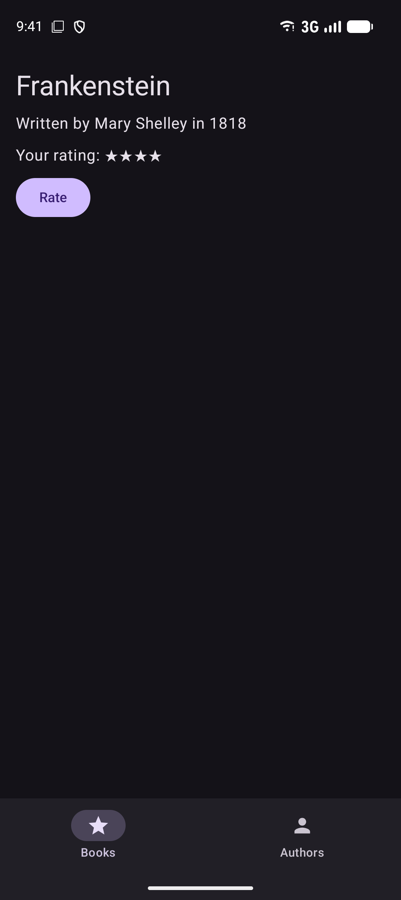
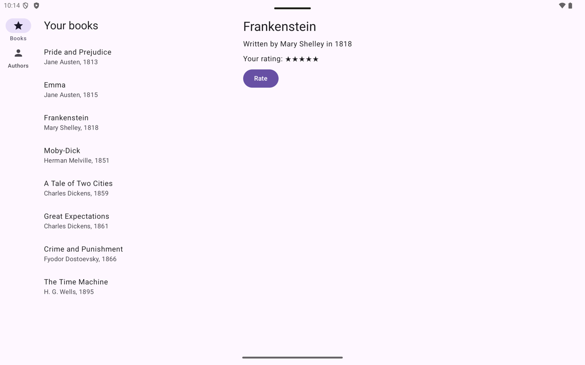

# Nav3 Bookshelf

A small Compose app that puts the main parts of [Jetpack Navigation 3](https://developer.android.com/guide/navigation/navigation-3)
in one place: typed keys, a back stack you own, arguments, a result sent back from a dialog, a
ViewModel per screen, bottom navigation with a back stack per tab, list-detail on wide screens,
deep links and predictive back. It's the companion code for my Medium guide on Navigation 3. It
needs no API key, no Google account and no Firebase project.

 

## What's inside

All the code is in `app/src/main/kotlin/dev/omerdurmaz/bookshelf/`.

| File | What it shows |
|---|---|
| `Keys.kt` | Every screen is a `@Serializable` `NavKey`. Arguments are plain properties. |
| `NavigationState.kt` | One saved back stack per tab, and entry decorators for saved state, ViewModels and results. Based on the official multiple back stacks recipe. |
| `Navigator.kt` | Navigation is list editing: switch tab, push, pop, replace, open a deep link's back stack. |
| `BookshelfApp.kt` | `entryProvider`, `NavDisplay`, the Material list-detail strategy, a dialog destination, the result going back from the dialog, and the tab bar/rail. |
| `BookDetailViewModel.kt` | A ViewModel scoped to one back stack entry, built from the key's argument. |
| `DeepLinks.kt` | `UriDeepLinkMatcher` with a synthetic back stack, so Back goes to the list instead of out of the app. |
| `MainActivity.kt` | Deep links on cold start and while the app is open, without applying them again after rotation. |
| `Screens.kt` | Plain composables that know nothing about navigation. |

## Try it

```bash
./gradlew installDebug
```

Open a book, tap **Rate**, pick the stars. Switch to **Authors**, open an author, then go back to
**Books**: each tab is where you left it. Rotate a phone to landscape or run it on a tablet and the
same back stack shows as list and detail side by side.

Deep links (the app can be closed or open):

```bash
adb shell am start -a android.intent.action.VIEW -d "nav3bookshelf://book/3"
```

```bash
adb shell am start -a android.intent.action.VIEW -d "nav3bookshelf://author/Jane%20Austen"
```

With more than one device attached, set `ANDROID_SERIAL` first.

## Tests

```bash
./gradlew testDebugUnitTest
```

19 tests, all on the JVM, so they also run in CI. `NavigatorTest` checks the back stack rules
without Compose. The rest use Robolectric and the Compose test APIs: the rating result, a new
ViewModel for every detail entry, tabs keeping their stacks, list-detail on a 1280dp window, deep
links on cold start, while running and after rotation.

## Gotchas this app works around

- **Back closes the app on tablets.** `rememberListDetailSceneStrategy()` defaults to
  `BackNavigationBehavior.PopUntilScaffoldValueChange`. With list and detail side by side, popping
  the detail leaves list + placeholder, which counts as "no change", so the scene reports nothing to
  go back to and the system closes the app. This app passes `PopUntilContentChange`.
- **Two tabs in one scaffold.** With one back stack per tab flattened into one `NavDisplay`, the
  Material strategy collects every list/detail entry with the same `sceneKey` (default `Unit`). Give
  each tab its own `sceneKey`, or the Authors tab shows a book as its detail pane.
- **`DeepLinkRequest(intent)` can throw.** An intent with no uri, no action, no type and no extras
  fails with "DeepLinkRequest must have either a uri or extras". Check `intent.data` first.
- **Transparent entries.** Without a background, the screen underneath shows through while a
  predictive back gesture moves the top one aside.
- **One `ViewModel` for every detail.** Without `rememberViewModelStoreNavEntryDecorator()`,
  `viewModel()` inside an entry is scoped to the Activity, so the second book shows the first one.
- **Results don't survive process death.** `ResultEventBus` is in memory. This app hands the stars
  to a ViewModel right away.

## Versions

Navigation 3 1.2.1, lifecycle-viewmodel-navigation3 2.11.0, Material 3 adaptive-navigation3 1.3.0,
Compose BOM 2026.09.00, AGP 9.5.1, Gradle 9.9.1, Kotlin 2.4.21, Robolectric 4.18. compileSdk 37,
minSdk 26. Tried on the Pixel 9 emulator (Android 16) and the Medium Tablet emulator (Android 15).

## Türkçe

Jetpack Navigation 3'ün temel parçalarını tek bir yerde gösteren küçük bir Compose uygulaması:
tipli key'ler, sahibi olduğunuz back stack, argümanlar, dialog'dan dönen sonuç, ekran başına
ViewModel, her sekmeye ayrı back stack, geniş ekranda list-detail, deep link ve predictive back.
Medium'daki Navigation 3 rehberimin örnek kodu. API anahtarı ya da Firebase gerekmiyor.
`./gradlew installDebug` ile kurun, yukarıdaki adb komutlarıyla deep link'leri deneyin. Yukarıdaki
"Gotchas" listesi, bu örneği yazarken karşılaştığım tuzakların özeti.

## License

Apache 2.0. See [LICENSE](LICENSE).
